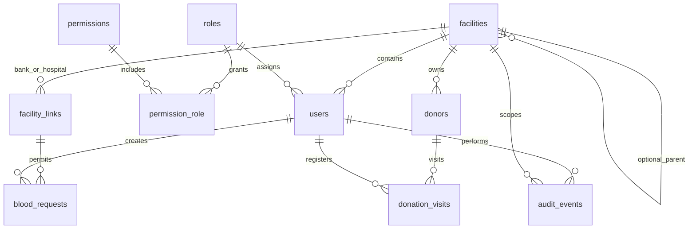

# MySQL data model — implemented foundation

The migration in `database/migrations/2026_10_20_000001_create_network.php` is the source of truth. MySQL 8.4 / InnoDB / utf8mb4; timestamps UTC. No production database is created remotely by repository upload.

| Table | Purpose / invariant |
|---|---|
| facilities | Immutable unique code and kind; state, ownership, governorate, optional administrative parent; collection-registration capability flag. |
| permissions | Explicit capability catalog; identifies capabilities permitted in custom local roles. |
| roles / permission_role | One role per account, permission many-to-many; national versus facility scope. System roles are immutable through UI. |
| users | Facility required for local roles at application boundary; national accounts have no facility. Password hashes, active state, forced password change. |
| facility_links | Unique bank/hospital pair; pending/review status, origin, requester and reviewer. Creator cannot approve own request. |
| blood_requests | ULID reference, approved-link endpoints, component/group as unverified request values, quantity, priority, encrypted patient reference. No unit allocation or clinical approval. |
| donors | Facility-scoped identity HMAC unique key; encrypted name, ID, phone, birth date; administrative ULID reference. |
| donation_visits | Composite donor/facility foreign key; unique nullable active_donor_id blocks concurrent open visits; timestamped consent reference. |
| audit_events | Actor, scope, event, record ID, allow-listed metadata and timestamp. Application model rejects updates/deletes; DB administrators can still alter data unless infrastructure controls are applied. |
| sessions / cache / cache_locks | Server-side encrypted sessions and rate-limiting/cache storage. |

Request link_id/bank_id/hospital_id is protected by a composite foreign key, not just UI filtering. A donor visit cannot reference a donor in another facility due to its composite foreign key. Parents are administrative only: no inheritance of access to clinical records.

Foreign keys restrict deletion of historical entities. No hard-delete routes exist. Critical request/link/visit changes use database transactions and row locks. UI double submission and database uniqueness are covered by tests; true multi-process stress/concurrency testing remains required.

## Future schema, not implemented
Donations, bag_lots, collection_events, samples, test_orders, test_results, quality_controls, component_lineage, blood_components, release_decisions, storage_devices, inventory_movements, temperature_readings, allocations, shipments, patient_samples, crossmatches, transfusion_events, recalls and disposals require separate clinical design and reviewed migrations. Do not place these facts inside the administrative blood_requests table.
